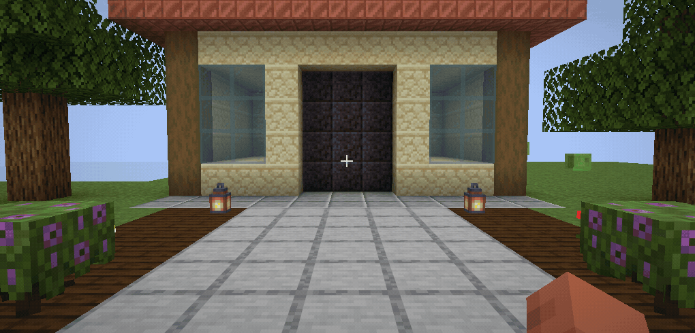
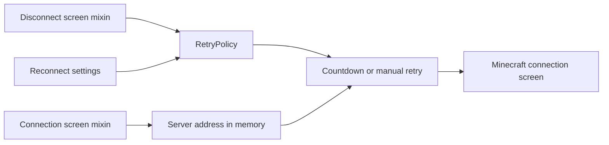

<div align="center">
<h1>Auto Reconnect</h1>
<hr>
<p><strong>2 reconnect controls in one place: manual retry, timed retry, bounded retry budgets.</strong></p>
<p>


</p>
<p>
<a href="https://github.com/hhhhhffd/AutoReconnect/releases"></a>

<a href="LICENSE"></a>
</p>
<p><a href="https://github.com/hhhhhffd/AutoReconnect/releases">Download</a> · <a href="#architecture">Architecture</a> · <a href="#build">Build</a></p>

</div>

## Overview

Auto Reconnect adds manual and automatic reconnect controls to the multiplayer disconnect screen. A client-side retry policy limits automatic attempts according to the disconnect cause and elapsed time.

## Technical Stack

| Area | Technology | Version / role |
| --- | --- | --- |
| Runtime | Minecraft Java | 1.21.11 |
| Runtime | Fabric Loader | 0.18.4 or later; client only |
| Runtime | Java | 21 or later |
| Optional | Mod Menu | 17 or later, for configuration |
| Build | Fabric Loom / Gradle | 1.13.6 / 9.2.1 |

## Architecture



- Mixins integrate with Minecraft's connection and disconnect screens; reconnecting uses the normal connection screen.
- `RetryPolicy` keeps cause classification and retry budgeting separate from the UI and networking.
- Mod Menu is compile-only and optional at runtime; settings persist locally, while the server address stays in memory.

## Project Structure

```text
.
├── build.gradle          # Loom build and dependencies
├── gradle.properties     # Minecraft and tool versions
├── gradle/wrapper/       # Gradle wrapper configuration
├── src/client/           # Retry policy, settings and mixins
├── src/main/             # Fabric metadata and resources
├── tests/                # Standalone retry-policy checks
└── docs/media/           # Demonstration
```

## Installation

1. Install Minecraft Java 1.21.11 with Fabric Loader 0.18.4 or later and Java 21 or later.
2. Download the JAR from [releases](https://github.com/hhhhhffd/AutoReconnect/releases) and place it in the client's `mods` folder.
3. Optionally install Mod Menu 17 or later to configure settings in game.

Auto Reconnect itself does not require Fabric API or anything on the server. Mod Menu is a build-time compile-only dependency, not a required runtime dependency.

## Usage and Settings

The multiplayer disconnect screen shows two buttons under **Back to Server List**:

- **Reconnect** immediately reconnects to the same server.
- **Auto Reconnect** shows the countdown and toggles automatic reconnect. Switch it off to cancel the current countdown, or select **Back to Server List** to leave.

With optional Mod Menu, open **Mods → Auto Reconnect → Configure**, change the default automatic behavior or first retry delay, then click **Done**. The buttons also work without Mod Menu. To configure without it, exit Minecraft and edit or create `config/autoreconnect.properties`:

```properties
autoReconnect=true
delaySeconds=5
```

| Setting | Default | Limits |
| --- | --- | --- |
| `autoReconnect` | `true` | Enables automatic reconnect by default |
| `delaySeconds` | `5` | 3–2147483647 seconds |

Settings from 1.0.0 carry over. The remembered server address is kept only in memory.

### Retry limits

An ordinary kick can trigger one automatic try. Network failures can use up to three tries, delayed by 1×, 2× and 4× the configured value, each capped at 2147483647 seconds. A stable 30-second rejoin resets the budget.

> [!NOTE]
> Automatic retry is not attempted for an initial failed connection, a deliberate Disconnect, or recognized bans, login denials, allowlist denials and protocol errors. Realms and server transfers are skipped.

## Build

Use Java 21 and the included Gradle wrapper:

```sh
./gradlew build
```

<details>
<summary>Standalone retry-policy checks</summary>

```sh
javac -d build/policy-test src/client/java/com/autoreconnect/RetryPolicy.java tests/RetryPolicyTest.java
java -cp build/policy-test RetryPolicyTest
```
</details>

## Links

- [Source](https://github.com/hhhhhffd/AutoReconnect)
- [Releases and downloads](https://github.com/hhhhhffd/AutoReconnect/releases)
- [Demo](docs/media/preview.gif)

## License

[MIT](LICENSE).
